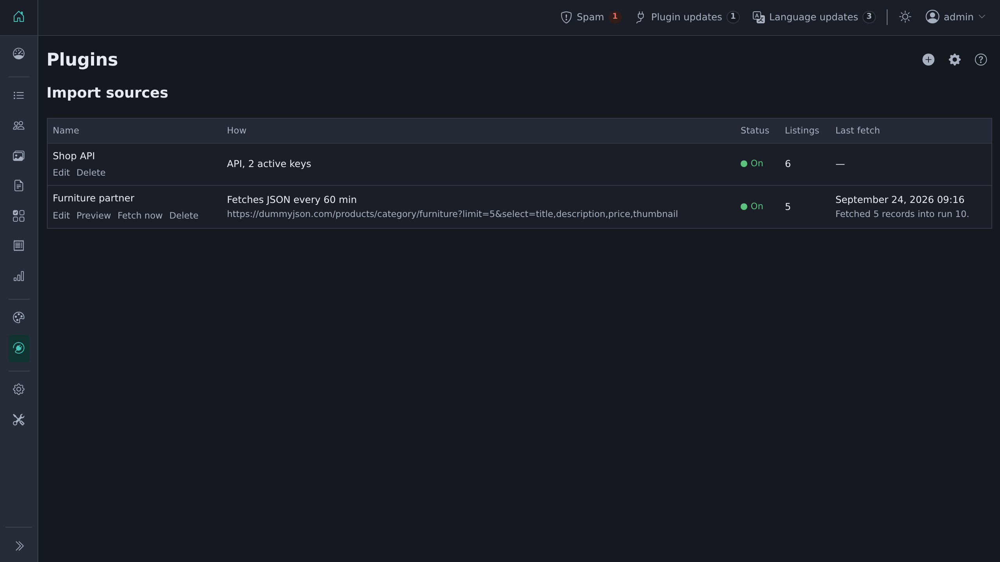
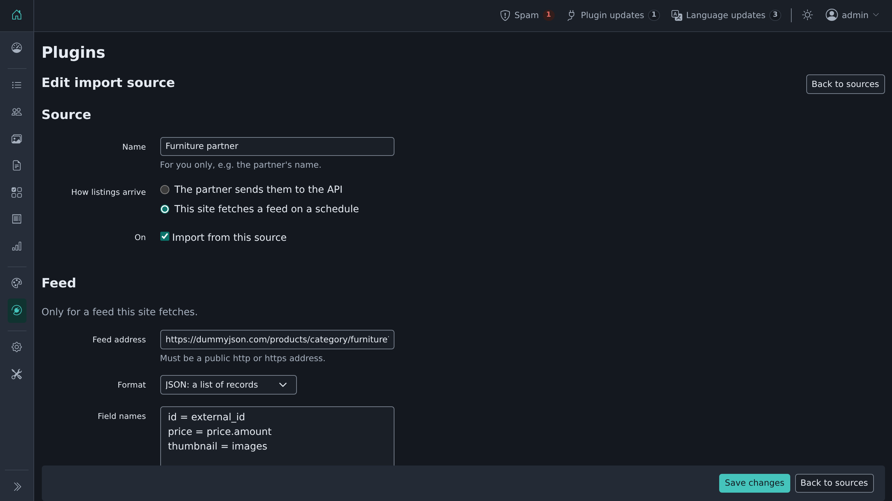
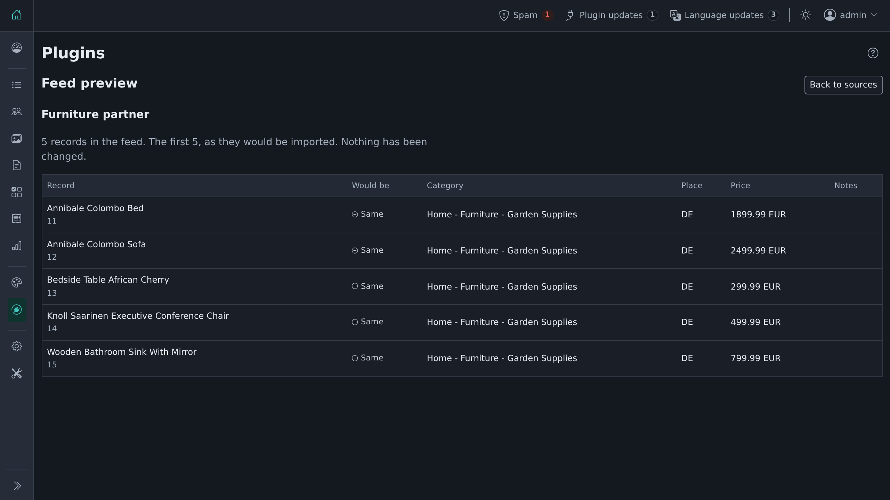
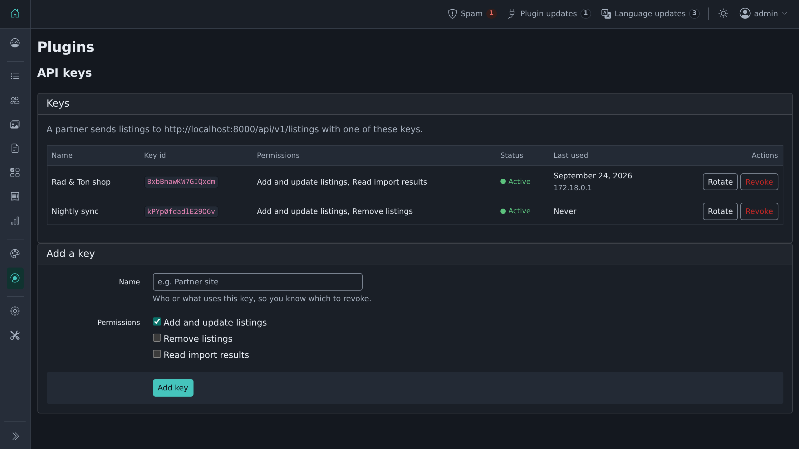

# Listing Import

Imports listings from other systems into Shopclass, through a keyed REST API or scheduled JSON, NDJSON, CSV and RSS feeds. Every listing goes through the same checks as one posted by hand: moderation, spam checks, listing limits and expiry.



| | |
|---|---|
|  |  |
| A feed source | Preview a feed before it changes anything |
|  | |
| A help screen with the API guide | |

## Requirements

- Shopclass 7.0 or later
- PHP 8.0 or later
- For the API: the REST API switched on under Settings → API

## Install

1. Open Plugins → Browse (or upload the zip from the GitHub release).
2. Install.
3. Activate.

(`php oc-cli.php market:install listing-import` also works.)

## Set up

Find everything under Plugins → Listing import: *Sources*, *Import a file*, *Settings*, *Help*.

**Pull a feed**

1. Open Plugins → Listing import → Sources and press *Add source*.
2. Give the feed address, its format and how often to fetch it. Formats: JSON, NDJSON, CSV, or another Shopclass site's RSS. Limit: 5,000 records and 20 MB.
3. If the feed names fields differently, map them one per line:

```
id = external_id
Headline = title
Town = location.city
Cost = price.amount
```

4. Press *Preview* to see what a fetch would import. Nothing changes. Press *Fetch now* to queue a fetch at once.

A JSON feed can be a plain list or an object holding one list, such as `{"products": [...]}`.

**Let a partner push listings**

1. Under Settings → API, make an admin key and tick the Listing import permissions (table below). The key is shown once.
2. Open Plugins → Listing import → Sources, edit the push source, and list the key's id under *API key ids*. A key linked to no source is refused. A key sees only its own source's listings and runs.
3. The partner sends the key on every request: `Authorization: Bearer <key>`.

| Permission | Lets the key |
|---|---|
| `ext:listing-import:write` | import listings, and read where one stands |
| `ext:listing-import:delete` | delete a listing it imported |
| `ext:listing-import:runs` | read how a batch went |

Or make a key from the command line:

```bash
php oc-cli.php api:key:create --admin=<username> --name="Partner site" --scopes=ext:listing-import:write,ext:listing-import:runs
```

Only admin keys can hold these permissions. Request limits are the site's, under Settings → API.

**Import a file**

Open Plugins → Listing import → Import a file. Upload a JSON, NDJSON, CSV or RSS file (up to 20 MB and 5,000 records) and choose its source. The preview shows how each record would be imported. Nothing changes until you press *Import*. Listings the file leaves out are not touched.

## How it works

- A listing whose record leaves a feed is deactivated, not deleted. It comes back when the record returns. If most records in a fetch fail, nothing is deactivated.
- A listing you delete in the admin stays deleted until its record changes. Then it is created again.
- Batches and feeds run with the site's background jobs. Make sure cron runs.

## Notes / limits

- The API is part of the site's REST API, under `/api/v1/ext/listing-import/`. The site describes every endpoint at `/api/v1/openapi.json`.
- Batch: up to 200 records. Request body: up to 1 MB.
- Images: up to 20 per record; JPEG, PNG, GIF or WebP, 8 MB each. The first 10 are fetched; the rest come back as a warning.

## For developers

### Send listings

| Request | What it does |
|---|---|
| `POST /api/v1/ext/listing-import/listings` | Import one record now. |
| `PUT /api/v1/ext/listing-import/listings/{external_id}` | The same, with the id in the address. |
| `GET /api/v1/ext/listing-import/listings/{external_id}` | The listing this id became, its address, and if it is live. |
| `DELETE /api/v1/ext/listing-import/listings/{external_id}` | Delete that listing. |
| `POST /api/v1/ext/listing-import/listings:batch` | Up to 200 records, imported in the background. |
| `GET /api/v1/ext/listing-import/runs/{id}` | How a batch went. |

The smallest record:

```json
{
  "external_id": "A-1001",
  "title": "Blue bike",
  "description": "A good bike, 21 gears.",
  "category": "Vehicles > Bikes"
}
```

The `external_id` is your id. Send the same id again and the plugin updates the listing it made
before. Send the same record again and nothing changes. There is no partial update: always send
the whole record.

An id in an address cannot hold a slash. Encode other characters as usual (`A%201001`).

Other fields, all optional:

- `category`: an id, a slug, a path, or `{"label": "Bikes"}`. A source can set a default.
- `price`: `{"amount": "1.234,50", "currency": "EUR"}`.
- `location`: `country`, `region`, `city`, `city_area`, `address`, `zip`, `lat`, `lng`. Names are
  matched to the site's own places.
- `contact`: `name`, `email`, `phone`, `show_email`.
- `owner`: `{"email": "seller@example.com"}` or `{"user_id": 12}` for an account on the site.
  Used only when the source allows records to choose accounts (off by default); otherwise
  ignored with a warning.
- `images`: one public `http`/`https` address, or a list of up to 20. JPEG, PNG, GIF or WebP, 8 MB each.
  The first 10 are fetched; the rest come back as a warning.
- `fields`: custom field slug → value.
- `title` and `description` may be per language: `{"en_US": "Bike", "de_DE": "Fahrrad"}`.
- `expires_at`, `published_at`: dates. `source_url`: the listing on your side.

A field the plugin does not know comes back as a warning. The record is still imported.

A batch answers at once with a run id:

```bash
curl -X POST https://example.com/api/v1/ext/listing-import/listings:batch \
  -H "Authorization: Bearer $KEY" -H "Content-Type: application/json" \
  -d '{"records": [ ... ]}'
```

```json
{"data":{"run_id":42,"records":150,"status":"queued"}}
```

The site's background jobs import the records. Check `GET /api/v1/ext/listing-import/runs/42` for the result.

### Errors

Errors follow RFC 9457 (`application/problem+json`), as the rest of the site's API does:

```json
{"type":"https://mindstellar.com/docs/developers/api/errors/#validation_failed","title":"The request is not valid.","status":422,"detail":"The record was not imported; see errors.","code":"validation_failed","errors":[{"pointer":"/title","code":"rejected","message":"Required.","in":"body"}]}
```

| Status | Code | Why |
|---|---|---|
| 400 | `invalid_json` | The body is not JSON. |
| 401 | `unauthorized` | No key, or a wrong one. |
| 403 | `forbidden`, `insufficient_scope` | The key is not an admin key, or lacks the permission. |
| 404 | `not_found` | No such endpoint, listing or run. |
| 405 | `method_not_allowed` | The endpoint does not take that method. |
| 409 | `conflict` | The key is linked to no source, or its source is switched off. |
| 413 | `too_large` | Body over 1 MB, or more than 200 records. |
| 415 | `unsupported_media_type` | Send `Content-Type: application/json`. |
| 422 | `validation_failed` | The record is wrong. `errors` says where. |
| 429 | `rate_limited`, `too_many_failures` | Too many requests. Wait for `Retry-After` seconds. |
| 500 | `server_error` | Something failed on the site. The site's error log says what. |

Request limits, and the lockout of an address that keeps sending a wrong key, are the site's
API settings.

### Command line

```bash
php oc-cli.php import:run --file=records.json --dry-run   # check a file, change nothing
php oc-cli.php import:run --file=records.ndjson           # import it now
php oc-cli.php import:status                              # the latest runs
php oc-cli.php jobs:work                                  # run queued batches and feeds now
```

## Support

https://github.com/mindstellar/shopclass-plugin-listing-import/issues

## License

GPL-3.0-or-later
